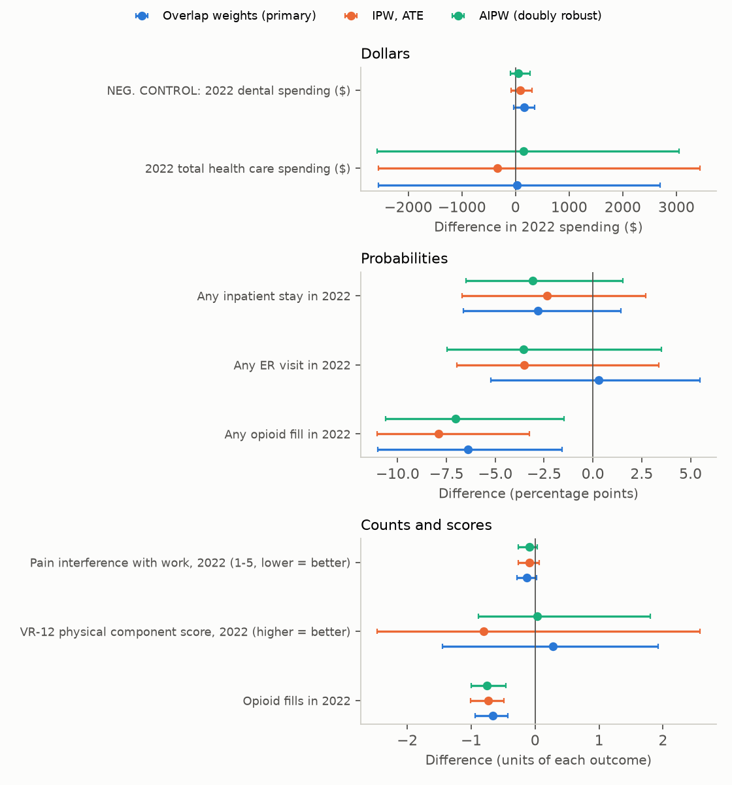
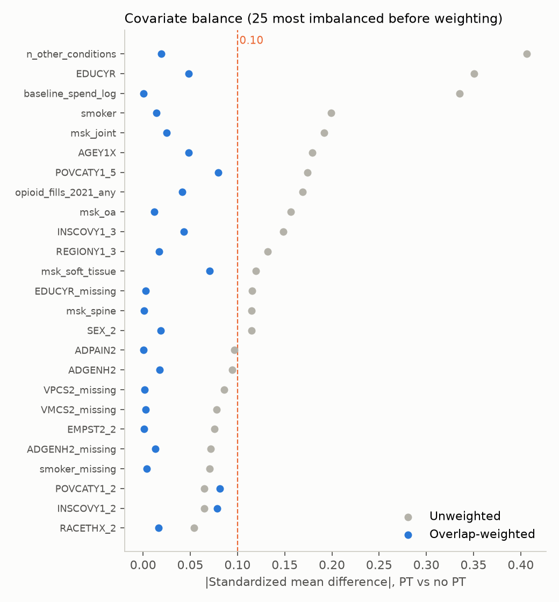
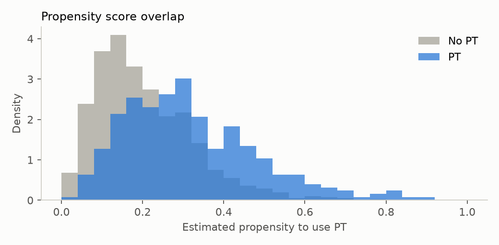

# Next-Year Signal

**Do adults with musculoskeletal pain who get physical therapy use fewer opioids and less care the following year? A
pre-registered real-world-evidence study on national survey data.**

> Digital MSK companies like Hinge Health argue that accessible, PT-style care lowers downstream cost and opioid use.
> This project asks what the observational evidence for physical therapy itself looks like in a nationally
> representative U.S. sample. It uses the methods a clinical-evidence team would use and is upfront about how
> fragile the answers are.

Data: AHRQ **Medical Expenditure Panel Survey (MEPS) Panel 26, 2021-2022**, public use files.
The [statistical analysis plan](docs/ANALYSIS_PLAN.md) was **committed before any outcome was computed** (see git
history). No changes were made after outcomes were seen.

---

## Results

**Population.** 21.3% of U.S. adults aged 18-84 had a musculoskeletal pain condition in 2021 (95% CI 20.0-22.6%,
about 54 million people). Of them, **22.2%** saw a physical or occupational therapist that year (19.6-24.9%), and
21.2% filled an opioid prescription. Analytic cohort: **1,372 adults, 315 with PT**.

**Primary estimator: overlap weights × survey weights** (estimand = the population with clinical equipoise).
95% CIs from 500 design-based bootstrap replicates (PSUs resampled within strata, propensity model re-fit each time).

| 2022 outcome | PT users | Comparable non-users | Difference (95% CI) | Reading |
|---|---|---|---|---|
| **Any opioid fill** (primary) | 14.5% | 20.9% | **−6.4 pts (−11.0 to −1.6)** | Evidence of a difference |
| Opioid fills per person | 0.49 | 1.15 | **−0.66 (−0.94 to −0.43)** | Evidence of a difference |
| **Total health care spending** (primary) | $15,234 | $15,208 | +$26 (−$2,557 to +$2,700) | No detectable difference |
| Any ER visit | 21.8% | 21.5% | +0.3 pts (−5.2 to +5.5) | Inconclusive |
| Any inpatient stay | 10.4% | 13.3% | −2.8 pts (−6.6 to +1.4) | Inconclusive |
| VR-12 physical function (PCS) | 44.5 | 44.2 | +0.3 (−1.5 to +1.9) | Inconclusive |
| Pain interference with work (1-5) | 2.11 | 2.24 | −0.13 (−0.28 to +0.02) | Inconclusive |
| *Negative control: dental spending* | *$780* | *$617* | *+$163 (−$37 to +$353)* | *CI includes 0, but leans positive* |



**Robustness.** The opioid result holds under all three pre-specified estimators: overlap weights −6.4 pts, IPW
(ATE, trimmed) −7.9 pts (−11.1 to −3.3), and doubly robust AIPW −7.0 pts (−10.6 to −1.5). Spending is null under all three.

**How to read the opioid finding.** By the plan's decision rule, it counts as evidence of a difference: the CI
excludes zero and the negative control's CI includes zero. Three reasons it is *not* proof that PT prevents opioid use:
1. **The negative control leans the wrong way.** PT users spent 26% more on dental care, a pattern consistent with
   healthier, better-insured or more care-engaged people choosing PT. The same "healthy user" effect could produce part of
   the opioid gap.
2. **E-value = 2.24.** An unmeasured confounder associated with both PT use and opioid use by a risk ratio of 2.24
   each, beyond the measured covariates, could fully explain it. Attitudes toward medication or a clinician's
   prescribing style could plausibly be that strong.
3. **Timing and linkage.** Exposure is *any* 2021 PT visit; MEPS public files don't link PT visits to the MSK condition
   or give exact visit dates relative to baseline measures.

**What this means for a digital MSK business.** Opioid avoidance is the outcome where the observational signal is
consistent. Total cost is where it isn't: with a standard deviation of ~$24,500 per person, a $2,600-wide CI is all a
cohort this size can give. Cost claims need either far larger data (claims) or randomization, which is what the next section sizes.

## Covariate balance

Before weighting, PT users differed substantially: more chronic conditions (SMD 0.41), more education (0.35), higher
baseline spending (0.34), fewer smokers (0.20). Overlap weighting brought **every covariate but one under |SMD| 0.10**;
the worst is 0.107 (one race/ethnicity category). IPW for the ATE balanced worse (10 covariates over 0.10 after
trimming 45 people with PS outside [0.05, 0.95]), which is why overlap weighting was pre-specified as primary.

| | |
|---|---|
|  |  |

## Designing the experiment that would settle it

For a randomized trial of an MSK program in a population like this one: how many members per arm for 80% power at
α = 0.05, and how much does adjusting for each member's prior-year value (CUPED) help? Correlations come from the same
people measured in 2021 and 2022.

| Outcome | Year-over-year correlation | Variance removed by CUPED | Effect to detect | n per arm, unadjusted | n per arm, CUPED |
|---|---|---|---|---|---|
| Physical function (PCS) | 0.77 | **59%** | 1 point | 2,189 | **907** |
| Pain interference (1-5) | 0.65 | 42% | 0.2 points | 566 | 326 |
| Any opioid fill | 0.45 | 20% | 3 pts | 2,532 | 2,026 |
| Total spending | 0.45 | 21% | $1,000 | 9,432 | 7,484 |
| Total spending, winsorized at p99 | 0.45 | 20% | $1,000 | 7,287 | 5,826 |

The design lesson: patient-reported function is cheap to test (CUPED cuts the sample by more than half), while
cost-savings claims need trials roughly ten times larger, or claims data at employer scale.

---

## Methods in brief
- **Cohort:** Panel 26 adults (18-84) in scope both years (`LONGWT > 0`) with a 2021 condition coded M15-M19, M25,
  M43-M54 or M60-M79 (3-character ICD-10 as released by MEPS).
- **Exposure:** at least one 2021 office-based or outpatient visit with a physical/occupational therapist
  (`MEDPTYPE_M18 = 10`).
- **Covariates (22 baseline variables, 40 model columns after dummies and missing-indicators):** demographics, poverty, insurance, region, education, employment, 2021
  spending *excluding* PT, 2021 opioid fill, non-MSK condition count, MSK subtype, diabetes, CHD, smoking, and baseline
  VR-12 PCS/MCS, pain interference and general health.
- **Estimators:** overlap weights (primary), trimmed IPW (ATE) and AIPW, all multiplied by the MEPS longitudinal weight.
  Descriptive prevalences use Taylor-linearized SEs.
- **Missing outcomes:** PCS (26% missing) and pain interference (30%) come from the self-administered questionnaire
  and are analyzed as complete cases. If nonresponse relates to both PT and the outcome, these two estimates are biased.

## Run it
```bash
python3 -m venv .venv && .venv/bin/pip install -r requirements.txt
./scripts/fetch_meps.sh                          # ~80 MB of AHRQ public files into data/raw/meps/
PYTHONPATH=src .venv/bin/python -m msk_rwe.cohort    # analytic cohort (data/processed/, gitignored)
PYTHONPATH=src .venv/bin/python -m msk_rwe.analysis  # estimates + 500-rep bootstrap (~13 min on an M2)
PYTHONPATH=src .venv/bin/python -m msk_rwe.power     # CUPED / sample sizes
PYTHONPATH=src .venv/bin/python -m msk_rwe.figures
.venv/bin/python -m pytest -q                         # method tests (E-value, weights, SMD, Taylor SE, cohort codes)
```
Person-level MEPS extracts are not committed; `results/` holds only aggregate outputs.

```
src/msk_rwe/  cohort.py (MEPS linkage)  causal.py (PS, weights, AIPW, SMD, bootstrap, E-value, Taylor SE)
              analysis.py (pre-specified run)  power.py (CUPED)  figures.py
docs/         ANALYSIS_PLAN.md  figures/
results/      summary.json  effects.csv  balance_smd.csv  propensity_scores.csv  power_cuped.json
```

## Limitations
- Observational design; residual confounding is likely (see the negative control and E-value).
- One two-year panel (n = 1,372), 2021-2022, a COVID-affected period for outpatient care.
- Survey self-report for events, with MEPS imputation of expenditures; 3-character ICD-10 only.
- The PSU bootstrap resamples with replacement within strata without the (n_h−1)/n_h rescaling, so CIs are slightly conservative.
- This evaluates PT in general, not Hinge Health or any digital program.

## Citation and disclaimer
Data: Agency for Healthcare Research and Quality, Medical Expenditure Panel Survey, HC-244, HC-231, HC-229A/F/G, HC-239A.
Analysis by Dev Shah; not affiliated with AHRQ or any company named. Not medical advice. MIT license (code).
